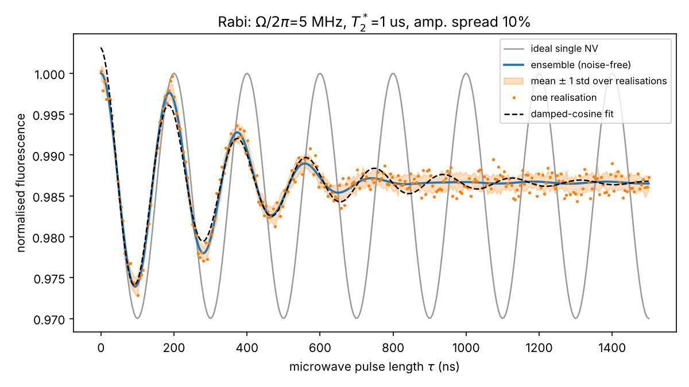
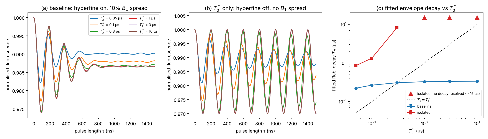
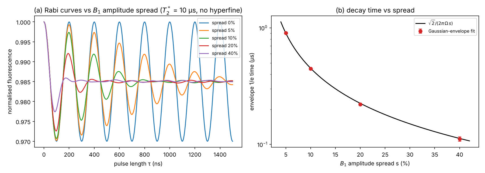
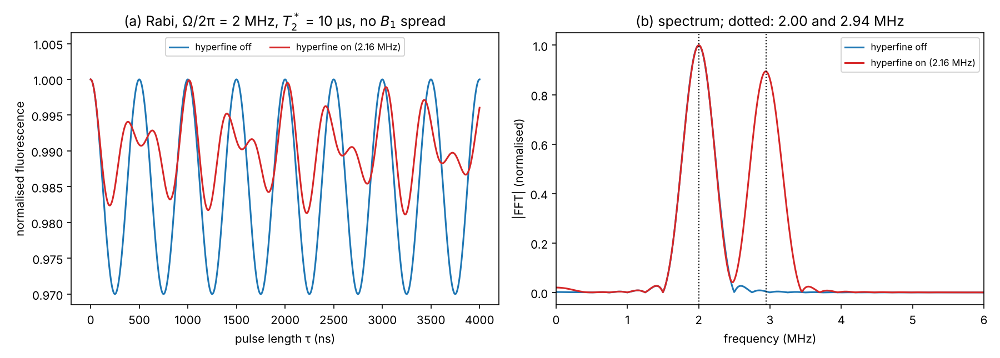
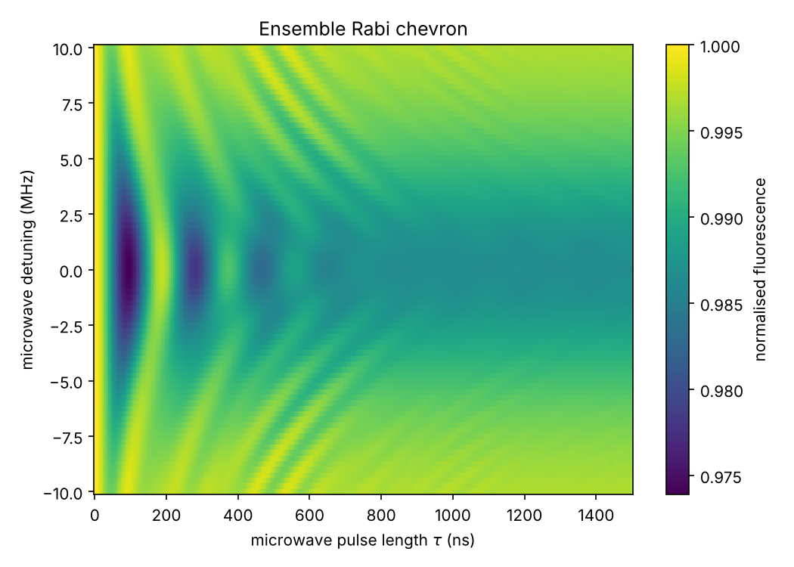
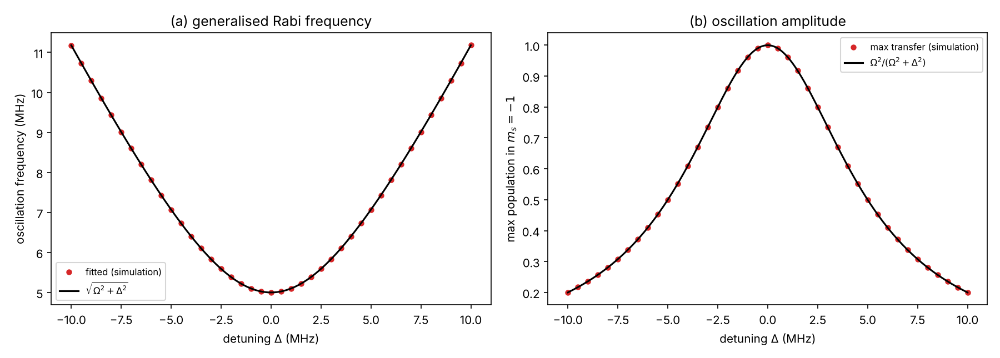
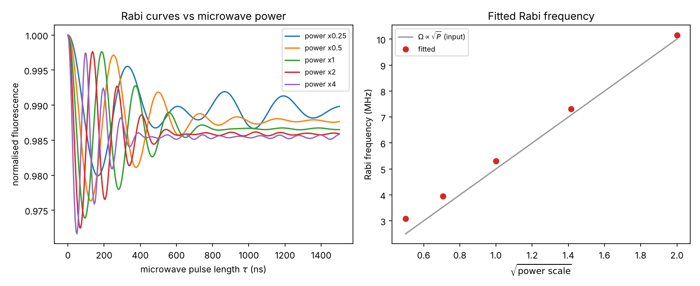
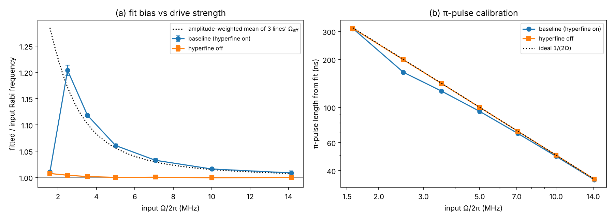
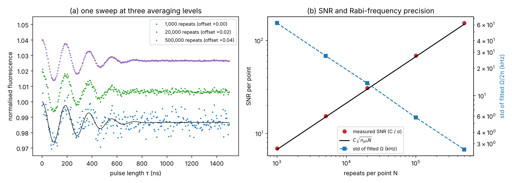

# Coherent Control of NV Centre Ensembles: A Simulation Study of Rabi Oscillations

*Undergraduate project report · November 2026*

## 1. Aim

The aim of this project was to learn how coherent microwave control of nitrogen-vacancy (NV) centres in diamond works, and to use the `rabi simulation` suite to see how drive and material parameters change the Rabi oscillations of an NV ensemble. I changed one parameter at a time from a baseline configuration and compared the simulated curves with simple analytic predictions. At the end I relate the results to the design of a compact, low-cost NV sensor.

## 2. Theory

### 2.1 The NV centre as a qubit

The negatively charged NV centre has a spin-1 ground state with sublevels m_s = 0 and m_s = ±1. The ±1 levels sit about D ≈ 2.87 GHz above m_s = 0 (zero-field splitting). A bias magnetic field along the NV axis splits them by 2γₑB∥, where γₑ ≈ 28 GHz/T. With the field applied, one transition, {0, −1}, can be driven on its own, and it behaves as a two-level system (a qubit).

Green light (≈ 532 nm) both initialises the spin into m_s = 0 and reads it out. The m_s = ±1 states fluoresce less than m_s = 0 because they can decay through a dark singlet path. The fractional difference is the **contrast** C: about 30% for a single NV and only a few percent for ensembles.

### 2.2 Driven two-level dynamics

In the rotating frame, under the rotating-wave approximation (RWA), a microwave field with Rabi frequency Ω and detuning Δ from resonance gives the Hamiltonian

$$
H = \frac{\Delta}{2}\sigma_z + \frac{\Omega}{2}\sigma_x .
$$

Starting in m_s = 0, the population in m_s = −1 after a pulse of length τ is

$$
P(\tau) = \frac{\Omega^2}{\Omega^2+\Delta^2}\,\sin^2\!\left(\frac{\Omega_{\rm eff}\,\tau}{2}\right), \qquad \Omega_{\rm eff} = \sqrt{\Omega^2+\Delta^2}.
$$

On resonance (Δ = 0) the population oscillates fully between the two states. A **π pulse** (τ_π = 1/(2Ω) with Ω in ordinary frequency units) flips the spin, and a **π/2 pulse** creates an equal superposition. The measured fluorescence is F = 1 − C·P, so a Rabi measurement is a fluorescence oscillation against pulse length. Its main practical use is to calibrate τ_π and τ_π/2 for every later pulse sequence (Ramsey, Hahn echo, dynamical decoupling).

### 2.3 Why ensembles are different

A sensor uses an ensemble of very many NVs to collect more light. Each NV sees slightly different conditions:

- **Detuning spread.** Local strain and the nitrogen spin bath shift each resonance. This sets the free-induction dephasing time T₂\*. For a Gaussian spread of standard deviation σ, T₂\* = √2 / (2πσ).
- **¹⁴N hyperfine structure.** The nitrogen nuclear spin (I = 1) splits each resonance into three lines about 2.16 MHz apart. A microwave tone on the centre line is off-resonant for two thirds of the spins.
- **Microwave amplitude (B₁) spread.** A large detection volume sees a non-uniform microwave field, so each NV has a different Ω and rotates by a different angle.

Averaging P(τ) over the ensemble makes the oscillation decay even though every individual spin is still coherent. Sections 4.2 to 4.4 look at each of these effects on its own.

## 3. Method

### 3.1 The simulation suite

The `rabi simulation` suite (`physics.py`, `main.py`, `plotting.py`, `noise.py`) models each NV as an independent two-level system using the formula in Section 2.2. For each spin *i* it draws:

- a resonance offset from a Gaussian of width σ = √2 / (2πT₂\*), plus a random hyperfine shift of −1, 0 or +1 times 2.16 MHz;
- a relative drive amplitude Ωᵢ = Ω(1 + s·gᵢ), where gᵢ is a standard normal number and s is the fractional amplitude spread.

The populations are averaged over the ensemble and converted to fluorescence. Photon shot noise is added as Poisson noise with (photons per shot × repeats) counts per point. The suite then fits a damped cosine, F = c + a·e^(−τ/T_d)·cos(2πfτ), to extract the Rabi frequency f and an envelope decay time T_d.

### 3.2 Baseline parameters

All runs start from the suite's `config.json`. The original file was not changed; each study used a modified copy.

| Parameter | Value | Meaning |
|---|---|---|
| Ω/2π | 5 MHz | Rabi frequency (ideal τ_π = 100 ns) |
| Δ | 0 MHz | microwave detuning from the centre line |
| Pulse lengths | 0 to 1500 ns, 300 points | Rabi sweep |
| Number of spins | 4000 | ensemble sample size |
| T₂\* | 1 µs | dephasing time (σ = 0.225 MHz) |
| B₁ amplitude spread | 10% | drive inhomogeneity |
| ¹⁴N hyperfine | on, 2.16 MHz | three-line structure |
| Contrast C | 3% | ensemble readout contrast |
| Photons per shot | 50 | detected photons per readout |
| Repeats per point | 20,000 | averaging |
| Sequence length | 5 µs | time per shot |
| Random seed | 1 | reproducibility |

### 3.3 Procedure

1. I ran `main.py` with the baseline configuration to get the reference Rabi curve, the detuning chevron and the power sweep (Figures 1, 5a and 6a).
2. I wrote a short driver script, `report_experiments.py`, which imports `physics.py` from the suite and runs each parameter study. Where I wanted to isolate one effect, I switched the others off (for example hyperfine off and B₁ spread set to zero).
3. For fitted quantities I kept one ensemble draw fixed and repeated the shot noise with 10 different seeds. Error bars are the standard deviation over those 10 fits.
4. All numerical results are saved in `figures/report_results.json` and `figures/baseline_summary.json`.

## 4. Results and discussion

### 4.1 Baseline Rabi oscillation

*Figure 1. Baseline Rabi measurement: ideal single NV (grey), noise-free ensemble (blue), one shot-noise realisation (orange dots, band = ±1 std over 20 realisations), and the damped-cosine fit (dashed).*

The single NV oscillates indefinitely between F = 1 and F = 1 − C = 0.97, with a period of 200 ns. The ensemble behaves differently in three ways:

- **Damping.** The oscillation dies out after roughly four periods. The fit gives T_d = 0.331 ± 0.009 µs over 20 realisations.
- **Reduced first dip.** At most 87% of the population is transferred (first minimum at about 94 ns), compared with 100% for a single NV.
- **Offset steady state.** The curve settles near 45% transfer, not 50%, because the off-resonant hyperfine lines never reach full transfer.

The fitted Rabi frequency was 5.307 ± 0.009 MHz, about 6% above the 5 MHz input. That would give τ_π ≈ 94 ns instead of 100 ns. Sections 4.4 and 4.6 show that this shift comes from the hyperfine lines. For an ensemble, the "π pulse" is a compromise: no single pulse length inverts every spin. The shot-noise SNR per point is C√(50 × 20000) = 30, and one 300-point sweep takes 300 × 20000 × 5 µs = 30 s.

### 4.2 Effect of dephasing time T₂\*

*Figure 2. (a) Rabi curves for T₂\* = 0.05 to 10 µs with the other baseline settings. (b) The same with hyperfine and B₁ spread switched off, so only T₂\* acts. (c) Fitted envelope decay T_d against T₂\*; triangles mark runs with no decay resolvable in the 1.5 µs window.*

| T₂\* (µs) | σ (MHz) | T_d, baseline (µs) | T_d, T₂\* only (µs) |
|---|---|---|---|
| 0.05 | 4.50 | 0.221 ± 0.012 | 0.85 ± 0.07 |
| 0.1 | 2.25 | 0.264 ± 0.010 | 1.33 ± 0.05 |
| 0.3 | 0.75 | 0.305 ± 0.009 | 8.2 ± 0.5 |
| 1 | 0.23 | 0.325 ± 0.009 | not resolved |
| 3 | 0.075 | 0.332 ± 0.009 | not resolved |
| 10 | 0.023 | 0.334 ± 0.009 | not resolved |

This result surprised me. I expected the Rabi decay time to follow T₂\*, but it does not:

- With only T₂\* acting (panel b), the oscillation hardly decays at all once Ω ≫ σ. For Δ ≪ Ω, Ω_eff ≈ Ω + Δ²/(2Ω), so a detuning spread only enters at second order. The drive "protects" the spins, and the decay rate scales roughly as σ²/Ω. Going from T₂\* = 0.3 µs to 0.1 µs (σ three times larger) shortened T_d by about a factor of six, of the order of the σ² scaling. At the shortest T₂\* values, σ approaches Ω and the oscillation amplitude also drops, as Ω²/(Ω²+Δ²) predicts.
- In the baseline (panel a), T_d stays near 0.33 µs for every T₂\* ≥ 0.3 µs. The decay there is set by the B₁ spread and the hyperfine lines, not by T₂\*.

So **the Rabi decay time is not a measurement of T₂\***. T₂\* has to be measured with a Ramsey sequence. This matches the statement in the primer that Rabi damping is "related to, but not the same as, T₂\*". Panel (c) also shows the T₂\*-only curves crossing T_d = T₂\*, so the two times are not even in a fixed ratio.

### 4.3 Effect of microwave amplitude inhomogeneity

*Figure 3. (a) Rabi curves for B₁ amplitude spreads of 0 to 40% (T₂\* = 10 µs, hyperfine off). (b) Envelope 1/e time from a Gaussian-envelope fit, compared with the analytic prediction.*

If Ωᵢ = Ω(1 + s·g) with g standard normal, averaging cos(2πΩᵢτ) over the ensemble gives cos(2πΩτ)·exp[−(2πΩsτ)²/2]. The envelope is Gaussian and falls to 1/e at

$$
T_{d} = \frac{\sqrt{2}}{2\pi\,\Omega\,s}.
$$

For this study I fitted a Gaussian envelope (the suite's built-in fit uses an exponential envelope, which is the wrong shape here).

| Spread s | Fitted T_d (µs) | Predicted T_d (µs) |
|---|---|---|
| 5% | 0.902 ± 0.021 | 0.900 |
| 10% | 0.451 ± 0.013 | 0.450 |
| 20% | 0.225 ± 0.007 | 0.225 |
| 40% | 0.113 ± 0.004 | 0.113 |

The agreement is within error for every point. B₁ inhomogeneity damps the Rabi signal much more strongly than T₂\* does, because it enters at first order: a 10% amplitude error is a 10% rotation-angle error on every pulse. For the baseline (10% spread), this alone limits the oscillation to T_d ≈ 0.45 µs, which explains most of the 0.33 µs seen in Section 4.1.

Since T_d ∝ 1/(Ωs), the number of coherent oscillations before decay, Ω·T_d ≈ 0.23/s, does not depend on Ω. Driving harder does not help; only a more uniform field does. This is why the literature puts so much effort into resonators and tuned loops that give a homogeneous B₁ over the sensing volume.

### 4.4 Effect of the ¹⁴N hyperfine structure

*Figure 4. (a) Rabi curves at Ω/2π = 2 MHz with hyperfine off (blue) and on (red); T₂\* = 10 µs, no B₁ spread. (b) Fourier transform of each curve; dotted lines at 2.00 and 2.94 MHz.*

With the hyperfine interaction switched on, a third of the spins are resonant and oscillate at Ω = 2 MHz. The other two thirds are detuned by ±2.16 MHz and oscillate at Ω_eff = √(2² + 2.16²) = 2.94 MHz, with a smaller amplitude of 4/(4 + 4.67) = 0.46. The spectrum in Figure 4(b) shows two peaks exactly at the predicted 2.00 and 2.94 MHz, and the time trace shows the beating between them.

The beating does not decay, because each group of spins is still fully coherent. It looks like damping only over a short window. This is the reason the fitted Rabi frequency in Section 4.1 is too high: the damped-cosine fit returns a weighted average of the two frequencies.

Ways to deal with this in a real experiment include driving with Ω much larger than 2.16 MHz (Section 4.6), using three microwave tones, or polarising the ¹⁴N nuclear spin.

### 4.5 Effect of microwave detuning (Rabi chevron)

*Figure 5a. Ensemble fluorescence against pulse length and detuning (baseline parameters). Dark = population transferred to m_s = −1.*

*Figure 5b. Line cuts from a T₂\*-only ensemble (hyperfine off, no B₁ spread, T₂\* = 10 µs, no shot noise). (a) Fitted oscillation frequency against detuning. (b) Maximum population transfer against detuning.*

The chevron shows the two signatures of the generalised Rabi formula:

- **Faster oscillations off resonance.** The fringes curve towards shorter τ as |Δ| grows, because Ω_eff = √(Ω² + Δ²) increases.
- **Weaker oscillations off resonance.** The dips become shallower, because the maximum transfer Ω²/(Ω² + Δ²) falls.

The line cuts agree with both formulas: the fitted frequency matches √(Ω² + Δ²) to within 0.3 kHz over ±10 MHz, and the transfer amplitude follows the Lorentzian Ω²/(Ω² + Δ²). The amplitude falls to half at |Δ| = Ω, so the full width of the response is 2Ω = 10 MHz. This is **power broadening**: a strong drive addresses a wide band of frequencies. That is helpful for an inhomogeneous ensemble (more spins are driven) but bad for spectroscopy, where a narrow line gives a steeper slope and better field sensitivity.

### 4.6 Effect of microwave power

*Figure 6a. Baseline Rabi curves for power scales 0.25 to 4 (left) and fitted Rabi frequency against √(power scale) (right).*

*Figure 6b. (a) Ratio of fitted to input Rabi frequency against drive strength, with hyperfine on (blue) and off (orange). The dotted line is the amplitude-weighted mean Ω_eff of the three hyperfine lines. (b) π-pulse length from the fit, with the ideal 1/(2Ω).*

Because Ω ∝ B₁ and the microwave power P ∝ B₁², the Rabi frequency should scale as √P. With hyperfine switched off, the fitted frequency follows the input to within 1% at every power, and τ_π follows 1/(2Ω) (Figure 6b, orange).

With hyperfine on, the fit overestimates Ω. The bias falls from about 20% at 2.5 MHz to under 1% at 14 MHz, and it follows the amplitude-weighted mean of the three lines' Ω_eff (dotted curve). The weakest drive (1.58 MHz) is an exception: there Ω is smaller than the 2.16 MHz splitting, so the two frequencies are well separated and the fit locks onto the stronger centre line instead of averaging.

Two practical points come out of this:

1. **A strong drive (Ω ≫ hyperfine splitting) makes the π-pulse calibration reliable.** At 10 MHz and above, the fitted τ_π is within 2% of the ideal value.
2. **More power gives faster pulses but not more of them.** With hyperfine off, the fitted decay time falls with power (0.35 µs at 5 MHz, 0.12 µs at 14 MHz), and for Ω/2π ≥ 5 MHz the product Ω·T_d stays at about 1.75 oscillations (the exponential fit gives a smaller number than the Gaussian estimate of 0.23/s = 2.3, but it is just as constant). This matches the B₁-spread result in Section 4.3: field uniformity, not power, limits pulse fidelity. Power also brings heating, which the primer lists as a practical limit.

### 4.7 Readout statistics and averaging

*Figure 7. (a) One baseline sweep at 1,000, 20,000 and 500,000 repeats per point (offset vertically for clarity). (b) Shot-noise SNR per point (red, with the prediction C√(n_ph·N)) and the standard deviation of the fitted Rabi frequency (blue, right axis).*

| Repeats per point N | SNR (measured) | SNR (C√(n_ph N)) | σ of fitted Ω/2π (kHz) | Time per sweep |
|---|---|---|---|---|
| 1,000 | 6.9 | 6.7 | 62 | 1.5 s |
| 5,000 | 15.4 | 15.0 | 27 | 7.5 s |
| 20,000 | 30.8 | 30.0 | 14 | 30 s |
| 100,000 | 68.9 | 67.1 | 5.8 | 2.5 min |
| 500,000 | 154 | 150 | 2.6 | 12.5 min |

The measured SNR follows C√(n_ph·N), and the precision of the fitted Rabi frequency improves as 1/√N. With only 3% contrast, the signal is very small compared with the shot noise: at 1,000 repeats the oscillation is barely visible by eye (Figure 7a). Every factor of 10 in precision costs a factor of 100 in measurement time.

This shows why contrast and photon collection matter so much for a sensor. The SNR depends on C√n_ph, so doubling the contrast is worth four times more photons or four times longer averaging.

## 5. Conclusions

From these simulations I learned the following about NV coherent control:

1. **A Rabi measurement is a calibration, and for an ensemble it is an imperfect one.** With the baseline settings the ensemble only transfers 87% of the population, and the fitted τ_π (94 ns) differs from the ideal 100 ns because of the hyperfine lines.
2. **Rabi decay is not T₂\*.** Under a strong drive, detuning spread only enters at second order, so T₂\* hardly affects the Rabi curve when Ω ≫ 1/T₂\*. It must be measured separately with Ramsey.
3. **Microwave field uniformity is the main limit on pulse fidelity.** B₁ spread damps the oscillation as exp[−(2πΩsτ)²/2], in close agreement with theory, and fixes the number of usable oscillations at about 0.23/s regardless of power.
4. **The ¹⁴N hyperfine structure produces beating and biases the fit**, unless the drive is much stronger than 2.16 MHz.
5. **Detuning follows the generalised Rabi formula exactly**, and the 2Ω power-broadened width shows the trade-off between addressing many spins and spectral resolution.
6. **Low contrast makes averaging expensive.** SNR grows only as √N, so contrast and photon collection efficiency are as important as the control itself.

For a compact, low-cost sensor this suggests: use a drive of at least ~10 MHz from a small loop or resonator, put the most design effort into making B₁ uniform over the diamond, and choose a diamond with an adequate T₂\* (measured by Ramsey, not inferred from the Rabi curve). Contrast and light collection set how long each measurement takes.

## 6. Limitations of the model

- **Rotating-wave approximation.** Valid while Ω ≪ the transition frequency (GHz), so fine for the MHz drives here.
- **Pure two-level model.** No T₁ or T₂ relaxation during the pulse, no optical pumping during the microwave pulse, and no leakage to m_s = +1 or the other three NV orientations.
- **Static, Gaussian spreads.** Real detuning and B₁ distributions may be non-Gaussian and can drift in time. The suite's noise model (1/f noise, thermal drift, vibration, pulse jitter) was left switched off for this report.
- **Finite ensemble.** 4000 sampled spins stand in for 10⁹ or more real ones. To avoid seeing sampling noise as physics, fits were repeated with a fixed ensemble draw.
- **Fitting model.** The single-exponential damped cosine is an approximation. The decay shapes here are Gaussian (B₁ spread) or non-decaying beats (hyperfine), so T_d values from that fit should be treated as an effective timescale only.

A natural next step would be to switch on the noise model and use the suite's sensitivity path (Path B) to estimate the magnetic sensitivity at the chosen working point.

## 7. References

1. NV Centre Coherent Control: A Primer for Quantum Physicists (project notes, Oct 2026).
2. Spec: noise model and sensitivity extension for nv_rabi_sim (project notes).
3. [Coherent control of NV⁻ centers in diamond in a quantum teaching lab](https://arxiv.org/pdf/2004.02643), arXiv:2004.02643.
4. [Sensitivity Optimization for NV-Diamond Magnetometry](https://arxiv.org/pdf/1903.08176), Barry et al., Rev. Mod. Phys. (2020).
5. [Impedance-tuned microwave loop for homogeneous Rabi oscillations](https://www.donheehamlab.org/_files/ugd/c1d187_95da1c7718044886a4e6b974a2ec34bf.pdf).
6. [Macro-scale diamond magnetometer with dynamical decoupling and a coplanar waveguide resonator](https://arxiv.org/pdf/1805.10725), arXiv:1805.10725.

## Appendix: files

| File | Contents |
|---|---|
| `figures/fig1_baseline_rabi.png`, `fig5a_chevron.png`, `fig6a_power_sweep.png` | `main.py` output for the baseline configuration |
| `figures/fig2` to `fig7` (other files) | Parameter studies from `report_experiments.py` |
| `figures/baseline_summary.json` | `main.py` summary for the baseline run |
| `figures/report_results.json` | All numbers from the parameter studies |
| `report_experiments.py` | Driver script (run from the `rabi simulation` folder: `python report_experiments.py config.json <output folder>`) |
